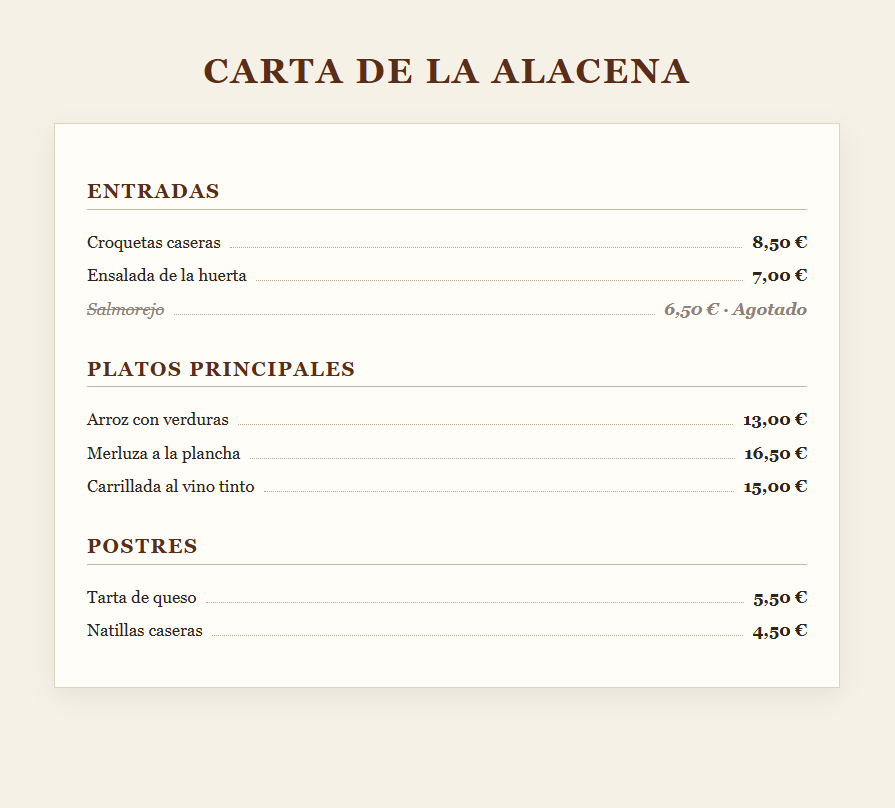

# Carta de La Alacena



## ¿Qué he creado y para qué sirve?

He creado **La Carta de La Alacena**, una aplicación web conectada a una **API REST** propia en PHP y MySQL que permite gestionar y mostrar de forma dinámica el menú de un restaurante.

Este proyecto sirve para **digitalizar la carta de un restaurante** evitando tener que modificar código HTML cada vez que cambia un precio, se añade un plato nuevo o se agota un producto en cocina:

- **Para los clientes del restaurante (`index.html`):** ofrece una carta digital limpia y fácil de leer, organizada automáticamente en **Entrantes**, **Platos principales** y **Postres**, con los precios formateados en euros y un aviso visual cuando algún plato está marcado como **Agotado**.
- **Para la gestión del restaurante (`api/`):** proporciona una API REST que permite consultar, crear, modificar y eliminar platos desde cualquier aplicación, panel de administración o herramienta como Postman, protegiendo las operaciones de escritura mediante una clave de acceso (*Bearer Token*).

---

## Cómo lo he creado

He construido el proyecto separando la base de datos, el servidor (API) y la parte visual (cliente web):

1. **Base de datos en MySQL (`datos/carta.sql`)**  
   He diseñado una tabla `platos` donde guardo cada plato con su `id`, `nombre` (único para evitar duplicados), `categoria` (`entrante`, `principal` o `postre`), `precio` y un campo `disponible` para saber si se puede servir o está agotado.

2. **API REST en PHP puro (`api/`)**  
   He desarrollado la API sin depender de frameworks externos, conectándome a la base de datos con **PDO** (`conexion.php`) y centralizando la configuración en `config.php`:
   - **Enrutamiento y autenticación (`api/.htaccess` y `api/index.php`):** he configurado Apache para que todas las peticiones pasen por `index.php` y reenvíe la cabecera `Authorization`. Las consultas (`GET`) son públicas para que cualquiera pueda ver la carta, mientras que crear (`POST`), editar (`PUT`) o borrar (`DELETE`) requieren enviar el token en la cabecera mediante `exigirClave()`.
   - **Operaciones y validaciones (`api/platos.php`):** he implementado las funciones del CRUD completo, validando los datos recibidos (nombre obligatorio, categoría válida y precio dentro de rango) para devolver errores claros (`422` si hay datos inválidos, `409` si el nombre ya existe o `404` si no se encuentra el plato).
   - **Respuestas JSON homogéneas (`api/ayudas.php`):** he agrupado aquí las funciones auxiliares para responder siempre en JSON UTF-8 y capturar excepciones inesperadas sin exponer detalles técnicos.

3. **Carta web dinámica (`index.html` y `js/funciones.js`)**  
   He maquetado una página con estética de carta tradicional (tipografía serif, fondo cálido, separadores con línea de puntos y estilo tachado para los platos agotados). Desde JavaScript realizo una llamada asíncrona con `fetch()` a `api/platos`, recibo el JSON y uso mi función `mostrarPlatos()` para agrupar los platos por categoría y construir el menú en el DOM.

4. **Documentación y pruebas**  
   También he incluido la especificación de la API en `openapi.yaml`, una página de documentación (`docs.html`) y una colección de Postman (`pruebas/carta.postman_collection.json`) con la que he ido probando cada endpoint y código de respuesta.

---

## Estructura del proyecto

```text
api_carta/
├── api/
│   ├── .htaccess         # Redirección de rutas a index.php y paso de Authorization
│   ├── ayudas.php        # Respuestas JSON, manejo de errores y validación Bearer
│   ├── conexion.php      # Conexión PDO a la base de datos
│   ├── config.php        # Parámetros de base de datos y clave de API
│   ├── index.php         # Punto de entrada y enrutador de métodos HTTP
│   └── platos.php        # Operaciones CRUD y validación de platos
├── datos/
│   └── carta.sql         # Script SQL con la estructura y datos iniciales
├── img/
│   └── carta-preview.png # Captura principal de la aplicación
├── js/
│   └── funciones.js      # Petición fetch a la API y renderizado de la carta
├── pruebas/
│   └── carta.postman_collection.json
├── docs.html             # Documentación web de la API
├── index.html            # Carta pública del restaurante
└── openapi.yaml          # Especificación OpenAPI de la API
```

---

## Cómo ponerlo en marcha

1. Copiar la carpeta del proyecto dentro del servidor web local (por ejemplo, `C:\xampp\htdocs\api_carta`).
2. Arrancar **Apache** y **MySQL** desde XAMPP.
3. Importar `datos/carta.sql` en phpMyAdmin para crear la base de datos `carta` con los platos iniciales.
4. Revisar la conexión y la `clave_api` en `api/config.php`.
5. Abrir `http://localhost/api_carta/` en el navegador para ver la carta en funcionamiento.
